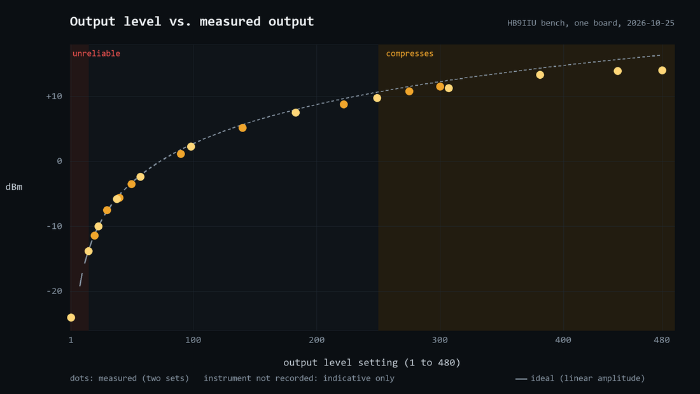

#  C3CAST

### The 5 EUR DATV modulator

**Plug. Flash. Play.** A small web console for DVB-S2 amateur TV from a low-cost ESP32-C3 board. **Windows 10/11.**

The board costs about 5 EUR. To get on the air via QO-100 you also need RF output filtering, an amplifier and a 2.4 GHz dish: see [Please read before transmitting](#please-read-before-transmitting).

  
   
  <b>&#9654; Press to play the demo video</b>

<h1 align="center"><a href="https://github.com/HB9IIU/C3CAST/releases/latest">&#11015; Download C3CAST for Windows</a></h1>

Windows 10/11 &nbsp;·&nbsp; no installation &nbsp;·&nbsp; unzip and double-click

C3CAST is a simple helper around the excellent **[ESP32-DATV](https://github.com/SP8ESA/ESP32-DATV)** firmware by
**Kacper SP8ESA**. His firmware does the real work: it turns the ESP32-C3's own Wi-Fi radio into a DVB-S / DVB-S2
transmitter on 13 cm. Please read his project for how it works, its measurements and its limits; this page does not repeat them.

# 🔌 PLUG &nbsp;·&nbsp; ⚡ FLASH &nbsp;·&nbsp; ▶ PLAY

C3CAST only wraps it for a **Seeed Studio XIAO ESP32-C3** so that a ham can get on the air without a toolchain:

1. **Plug** the XIAO into a USB port (the native USB port, no extra adapter).
2. **Flash** it from the page: one button, two clicks, about 30 seconds. A brand-new blank board works too.
3. **Play**: pick a picture, the SBB clock card or a USB camera, choose symbol rate and FEC, press **Start**.

by HB9IIU

## The board

The whole modulator is one **[Seeed Studio XIAO ESP32-C3](https://www.seeedstudio.com/Seeed-XIAO-ESP32C3-p-5431.html)**, a
thumb-sized board that costs about 5 EUR / USD (Seeed lists it at $4.90; shop and shipping change that).

- **Chip:** ESP32-C3, RISC-V at 160 MHz, 4 MB flash, 320 KB RAM, 2.4 GHz Wi-Fi and Bluetooth LE.
- **USB-C:** the chip's *native* USB. It is the only cable you need: the PC sends the symbols over it and C3CAST flashes through it.
- **U.FL connector** (bottom centre): the RF output. Use a small antenna, or a dummy load / attenuator for bench tests.
- **B / R buttons:** boot and reset. Flashing resets the board over USB by itself; if a board is ever not found, hold **B** while
  plugging it in to force download mode.
- **Pin D10:** the PTT output of C3CAST (high while transmitting). D9 is the boot button: do not pull it low at power-up.

The RF is produced by the chip's own Wi-Fi radio, driven by SP8ESA's firmware; there is no other RF hardware on the board. C3CAST is
built and tested on this XIAO. SP8ESA's own project uses an ESP32-C3 SuperMini.

## What you get

- **Flash button**: installs the firmware (SP8ESA's, with the PTT pin moved to D10) over the same USB cable. It only flashes the
  board you pick and confirm. No Arduino IDE, no PlatformIO needed to use it.
- **Three sources**: a PNG/JPG picture, a live **SBB station-clock test card**, or a **USB camera** with callsign, UTC time and a
  scrolling marquee on the picture.
- **Frequency**: click a free slot on the **live QO-100 wideband spectrum** (the BATC feed) or just type it
  (2300 to 2450 MHz, always possible, also offline and for bench tests). The page shows the downlink slot and whether it *looks* free on the live spectrum. That is only a hint: always listen first.
- **Link settings**: DVB-S2 QPSK, symbol rates 125 / 250 / 333 / 500 / 1000 kS/s, FEC 1/2, 3/5, 2/3, 3/4 or 4/5, output level with limits you set yourself ([what that means](#output-level)).
- **Video settings are automatic**: picture size, bitrate and audio follow the symbol rate (H.265 and AAC-LC, the same
  strategy as QOCAST). It uses the NVIDIA GPU encoder when there is one, otherwise software encoding. You never set video parameters yourself.
- **PTT output on D10**: high while RF is on, low otherwise; to key a relay or an amplifier through its own driver.
- **Finds the board by itself** (and remembers it), shows UTC, runs offline (no internet needed), one Start/Stop button.

## Quick start (Windows)

No installation, no Python, no drivers to set up:

1. Download the portable package **C3CAST-Portable-x64** (the `.zip` on the [Releases page](https://github.com/HB9IIU/C3CAST/releases/latest)) and unzip it anywhere.
2. Double-click **C3CAST.exe**. A small window opens (close it to quit) and your browser shows the page.
3. Plug in the XIAO. If the page does not say *board connected*, press **Flash**.
4. **Set up once** on the **Setup** page: callsign and locator.
5. **Choose a source**: a picture, the SBB clock card or a USB camera.
6. **Choose frequency, symbol rate and FEC.** Click a slot on the spectrum or type the frequency. Start at a low output level.
7. Press **Start**, then check your spectrum and the picture on a receiver. **Stop** ends the transmission, **END** closes the app.

Start on a dummy load or an attenuator first.

Your own pictures go in the `pictures` folder next to the exe, your settings are saved in `config.json` there, and callsign, locator
and clock lead time are on the **Setup** page.

## Please read before transmitting

- **Licensed radio amateurs only.** You are responsible for the frequency, power and bandwidth you use.
- **For on-air operation, use suitable RF output filtering and verify the transmitted spectrum**, as recommended by SP8ESA.
  See the [upstream project for measurements](https://github.com/SP8ESA/ESP32-DATV#spectra). Start bench tests with a dummy load or attenuator.
- C3CAST is made for experiments, not for calibrated power: see *Output level* below.

### Output level

The Level slider starts at **Off** (nothing is sent). Its next step is your **lowest** level and it runs up to your **highest** level.
You set both with the **Limits** button next to the Level slider: drag two handles on one track (1 to 480; the default is 15 to 100). This is a digital amplitude setting,
**not calibrated power**: start low and check your own spectrum before raising it. The slider returns to Off whenever
transmission stops, so choose a level before each new transmission.

**Very low levels** (below about 15) show a spike in the middle of the signal, the board's own carrier leakage. For less power,
keep the level at 15 or more and use an attenuator after the board. **High levels** (above about 250) distort the signal.
HB9IIU measured one board: the output follows the setting closely up to about 100, compresses above about 250 (which usually means
more distortion), and is unreliable below about 15.

The plot shows the firmware's whole range (1 to 480), which the measurements covered. The instrument and its settings were not recorded, so treat the numbers as indicative. The full table is in
[docs/BUILD_AND_TEST_NOTES.md](docs/BUILD_AND_TEST_NOTES.md).

## Video files and experimental H.266 / VVC

**Video:** put MP4, MKV, MOV, AVI, WebM, TS or M4V files in the `videos` folder next to C3CAST.exe (from source: `webapp/videos`),
choose **Video** and press Reload. The selected file loops until Stop, with its soundtrack, or silence if it has none.
Two sample films are included: an excerpt of *Big Buck Bunny* and the *Sintel* trailer, (c) Blender Foundation, CC BY 3.0
(see `videos/CREDITS.txt`). The muted browser preview depends on the browser's codec support; transmission uses ffmpeg's decoders.
Almost any video works. **Best:** MP4 with H.264 or H.265 and AAC sound, 16:9, 1280x720 or smaller, 25 or 30 frames per second.
C3CAST describes the chosen file under its name, warns when it is too large for your PC to decode live (bigger than 1080p, or above
30 fps), and the **i** button shows how to prepare a file with the ffmpeg that comes in the package.

 
VVC logo (c) Fraunhofer HHI, shown only to identify the video format. No endorsement by Fraunhofer is implied.
<a href="https://www.hhi.fraunhofer.de/en/departments/vca/technologies-and-solutions/h266-vvc.html">About H.266 / VVC</a>

> **⚠ Most DATV viewers cannot decode H.266.** They will see no picture. Use this mode only for tests with stations that have agreed to take part, and switch back to H.265 for normal operation. C3CAST asks you to confirm before it transmits in H.266.

The **H.266 / VVC** switch is off whenever the console opens, and its "i" button explains the mode in plain language. H.265 stays
the normal mode, with the same automatic GPU or software selection as before. H.266 uses the CPU through ffmpeg's `libvvenc`
encoder, so it may take several seconds to produce a picture, and the larger profiles may not keep up in real time. Picture size
and frame rate follow the existing profiles; a first [benchmark on an i5-11600K](docs/H266_BENCHMARK_2026-10-29.md) found the
higher-resolution H.266 profiles too slow. Audio stays AAC-LC, and the transport stream and radio settings stay the same.
It has been tested only briefly on air by HB9IIU; more testing by other users is welcome.

To watch H.266, VLC 3 and QOCAST's normal Player are not enough. The package includes the **HB9IIU Experimental H.266 Player**
(folder `H266-Player`, start it with the **Player** button at the top of the page or by double-clicking its exe). It receives with a
MiniTiouner or a USB PicoTuner, shows the live QO-100 spectrum, and decodes H.265, H.264 and H.266 with its own ffplay. It is
optional: delete the folder and the button disappears, and Open Tuner or any other receiver keeps working as before. A recent ffplay
with VVC decoding (ffmpeg 7.1 or newer) also works, and you should always check your receiving chain.
Developer tests are in [docs/H266_TESTING.md](docs/H266_TESTING.md).

## Bench test

No spectrum analyser? HB9IIU's **[Pocket QO-100 Spectrum Viewer](https://github.com/HB9IIU/ESP32-CYD-pocket-qo-100-spectrum-viewer)** shows
C3CAST's signal as a TX slot: a receive-only *"is it transmitting?"* indicator, not a measurement. Never connect the transmitter output
directly to it.

## Status

Version **1.0.0-beta.4** (beta). Verified on air so far: DVB-S2 QPSK at 500 kS/s with the USB camera source, received on a MiniTioune. The other
symbol rates, FEC values and sources are checked offline (streams analysed without errors) but not all confirmed on air yet.
The firmware comes from the SP8ESA project, so its limits apply: see his page for compatibility details.

### What's new in 1.0.0-beta.4

- **H.266 Player included:** the package now carries the HB9IIU Experimental H.266 Player, a receiver for MiniTiouner and PicoTuner that also plays H.265. A **Player** button at the top of the page starts it. It is optional: delete the `H266-Player` folder and the button disappears.
- **Video files are described and checked:** under the file name C3CAST shows size, frame rate, codec, length and whether it has sound, warns when a file is too big to decode live, and an **i** button explains how to prepare one.
- **More FEC values:** 1/2, 3/5 and 2/3 next to 3/4 and 4/5, for stations with a small dish (a lower FEC needs less signal and carries less video; 3/4 stays the default). Checked offline, not yet received on air.
- **Your own output level limits:** a **Limits** button next to the Level slider opens a popup with two handles, for your lowest and your highest level (1 to 480; default 15 to 100). The slider starts at Off, then runs between your limits, so the bad very low levels cannot be picked by accident.

Earlier in beta.3: video files as a source, a safer level control that starts at zero, and the experimental H.266 mode (with its warning).

The full history is in the [changelog](docs/CHANGELOG.md).

## Notes

- **ffmpeg** (H.265, H.266 and AAC) is included in the portable package. When building from source, put one in `tools/ffmpeg/bin/`;
  it is not part of this repository.
- **Camera** support uses Windows DirectShow; other systems are not supported yet.
- **Firmware source** is in `src/` (PlatformIO, ESP-IDF 6.1). To rebuild it: `pio run`, then `python tools/export_firmware.py`
  to refresh what the Flash button writes.
- More details in the [changelog](docs/CHANGELOG.md), the [build and test notes](docs/BUILD_AND_TEST_NOTES.md) and [how it works](docs/HOW_IT_WORKS.md).

## Credits and licence

- **ESP32-DATV firmware: Kacper SP8ESA** (<https://github.com/SP8ESA/ESP32-DATV>). All the clever part is his work.
- **HB9IIU Experimental H.266 Player** (folder `H266-Player`): GPL v3, contains code from Open Tuner by ZR6TG and contributors. Its source is in `H266-Player/source` and at <https://github.com/HB9IIU/HB9IIU-Experimental-H266-Player>.
- **BATC**: the live QO-100 wideband spectrum feed (`eshail.batc.org.uk`), shown read-only. It needs an internet connection.

**Licence: PolyForm Noncommercial 1.0.0, the same as the firmware** (see [LICENSE](LICENSE) and the firmware's [LICENSE.upstream](LICENSE.upstream)). Free for noncommercial use, which the licence
explicitly says includes hobby projects and amateur pursuits. Anyone you pass a copy to must get the licence text and the
*Required Notice* lines at the top of `LICENSE` (HB9IIU for C3CAST, SP8ESA for the firmware). No commercial use.

Third-party parts keep their own licences: the Varela Round font (SIL OFL, in `webapp/fonts/`), esptool and the other Python
packages (installed by pip, not in this repository), and **ffmpeg** (a GPL build, shipped in the portable package but not in this repository; its licence text and notices are included there).

73 de HB9IIU
