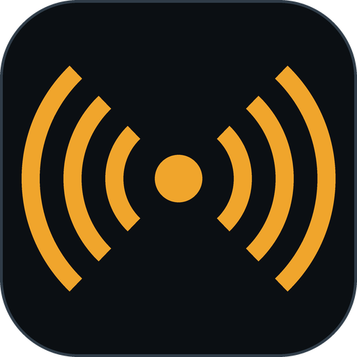
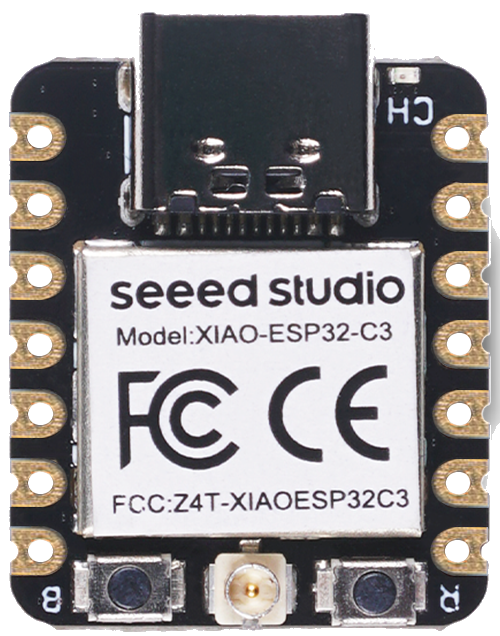

#  C3CAST

### The 5 EUR DATV modulator

**Plug. Flash. Play.** A small web console for DVB-S2 amateur TV from a low-cost ESP32-C3 board.

  
   
  <b>&#9654; Press to play the demo video</b>

C3CAST is a simple helper around the excellent **[ESP32-DATV](https://github.com/SP8ESA/ESP32-DATV)** firmware by
**Kacper SP8ESA**. His firmware does the real work: it turns the ESP32-C3's own Wi-Fi radio into a DVB-S / DVB-S2
transmitter on 13 cm. Please read his project for how it works, its measurements and its limits; this page does not repeat them.

# 🔌 PLUG &nbsp;·&nbsp; ⚡ FLASH &nbsp;·&nbsp; ▶ PLAY

C3CAST only wraps it for a **Seeed Studio XIAO ESP32-C3** so that a ham can get on the air without a toolchain:

1. **Plug** the XIAO into a USB port (the native USB port, no extra adapter).
2. **Flash** it from the page: one button, two clicks, about 30 seconds. A brand-new blank board works too.
3. **Play**: pick a picture, the SBB clock card or a USB camera, choose symbol rate and FEC, press **Start**.

by HB9IIU

## The board

The whole modulator is one **[Seeed Studio XIAO ESP32-C3](https://www.seeedstudio.com/Seeed-XIAO-ESP32C3-p-5431.html)**, a
thumb-sized board that costs about 5 EUR / USD (Seeed lists it at $4.90; shop and shipping change that).

- **Chip:** ESP32-C3, RISC-V at 160 MHz, 4 MB flash, 320 KB RAM, 2.4 GHz Wi-Fi and Bluetooth LE.
- **USB-C:** the chip's *native* USB. It is the only cable you need: the PC sends the symbols over it and C3CAST flashes through it.
- **U.FL connector** (bottom centre): the RF output. Use a small antenna, or a dummy load / attenuator for bench tests.
- **B / R buttons:** boot and reset. Flashing resets the board over USB by itself; if a board is ever not found, hold **B** while
  plugging it in to force download mode.
- **Pin D10:** the PTT output of C3CAST (high while transmitting). D9 is the boot button: do not pull it low at power-up.

The RF is produced by the chip's own Wi-Fi radio, driven by SP8ESA's firmware; there is no other RF hardware on the board. C3CAST is
built and tested on this XIAO. SP8ESA's own project uses an ESP32-C3 SuperMini.

## What you get

- **Flash button**: installs the firmware (SP8ESA's, with the PTT pin moved to D10) over the same USB cable. It only flashes the
  board you pick and confirm. No Arduino IDE, no PlatformIO needed to use it.
- **Three sources**: a PNG/JPG picture, a live **SBB station-clock test card**, or a **USB camera** with callsign, UTC time and a
  scrolling marquee on the picture.
- **Frequency**: click a free slot on the **live QO-100 wideband spectrum** (the BATC feed) or just type it
  (2300 to 2450 MHz, always possible, also offline and for bench tests). The page shows the downlink slot and whether it is free.
- **Link settings**: DVB-S2 QPSK, symbol rates 125 / 250 / 333 / 500 / 1000 kS/s, FEC 3/4 or 4/5, output level 1 to 480.
- **Sensible video settings automatically**: picture size, bitrate and audio follow the symbol rate (H.265 and AAC-LC, the same
  strategy as QOCAST). It uses the NVIDIA GPU encoder when there is one, otherwise software encoding. Nothing to configure.
- **PTT output on D10**: high while RF is on, low otherwise; to key a relay or an amplifier through its own driver.
- **Finds the board by itself** (and remembers it), shows UTC, runs offline (no internet needed), one Start/Stop button.

## Quick start (Windows)

No installation, no Python, no drivers to set up:

1. Download the portable package **C3CAST-Portable-x64** (the `.zip` on the Releases page) and unzip it anywhere.
2. Double-click **C3CAST.exe**. A small window opens (close it to quit) and your browser shows the page.
3. Plug in the XIAO. If the page does not say *board connected*, press **Flash**.

Your own pictures go in the `pictures` folder next to the exe, your settings are saved in `config.json` there, and callsign, locator
and clock lead time are on the **Setup** page.

## Please read before transmitting

- **Licensed radio amateurs only.** You are responsible for the frequency, power and bandwidth you use.
- **For on-air operation, use suitable RF output filtering and verify the transmitted spectrum**, as recommended by SP8ESA.
  See the [upstream project for measurements](https://github.com/SP8ESA/ESP32-DATV#spectra). Start bench tests with a dummy load or attenuator.
- C3CAST is made for experiments, not for calibrated power: see *Output level* in `docs/BUILD_AND_TEST_NOTES.md`.

## Bench test

No spectrum analyser at hand? HB9IIU's **[Pocket QO-100 Spectrum Viewer](https://github.com/HB9IIU/ESP32-CYD-pocket-qo-100-spectrum-viewer)**
(an ESP32 "Cheap Yellow Display") listens in the 2401-2410 MHz band and draws a live spectrum and waterfall. Put it near the XIAO and
C3CAST's 2405.000 MHz shows up as a TX slot, so you can see at a glance that the signal is really on the air, with no cable involved.

It is a receive-only *"is it transmitting?"* indicator with relative levels, not a measurement. To look at images and spurs, use a
spectrum analyser or an SDR with proper attenuation. Never connect the transmitter output directly to the viewer.

## Status

Version **1.0.0-beta.1** (first beta). Verified on air so far: DVB-S2 QPSK at 500 kS/s with the USB camera source, received on a MiniTioune. The other
symbol rates, FEC values and sources are checked offline (streams analysed without errors) but not all confirmed on air yet.
The firmware comes from the SP8ESA project, so its limits apply: see his page for compatibility details.

## Notes

- **ffmpeg** (H.265 and AAC) is included in the portable package. When building from source, put one in `tools/ffmpeg/bin/`;
  it is not part of this repository.
- **Camera** support uses Windows DirectShow; other systems are not supported yet.
- **Firmware source** is in `src/` (PlatformIO, ESP-IDF 6.1). To rebuild it: `pio run`, then `python tools/export_firmware.py`
  to refresh what the Flash button writes.
- More details in `docs/CHANGELOG.md` and `docs/BUILD_AND_TEST_NOTES.md`.

## Credits and licence

- **ESP32-DATV firmware: Kacper SP8ESA** (<https://github.com/SP8ESA/ESP32-DATV>). All the clever part is his work.
- **BATC**: the live QO-100 wideband spectrum feed (`eshail.batc.org.uk`), shown read-only. It needs an internet connection.

**Licence: PolyForm Noncommercial 1.0.0, the same as the firmware** (see `LICENSE`). Free for noncommercial use, which the licence
explicitly says includes hobby projects and amateur pursuits. Anyone you pass a copy to must get the licence text and the
*Required Notice* lines at the top of `LICENSE` (HB9IIU for C3CAST, SP8ESA for the firmware). No commercial use.

Third-party parts keep their own licences: the Varela Round font (SIL OFL, in `webapp/fonts/`), esptool and the other Python
packages (installed by pip, not part of this repository), ffmpeg (not included).

73 de HB9IIU
